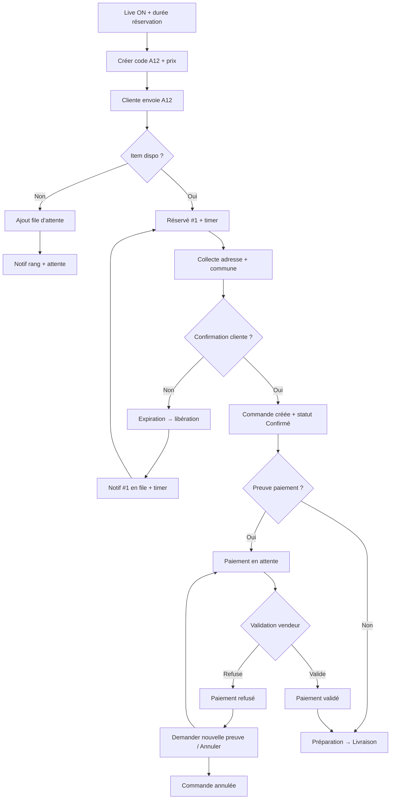
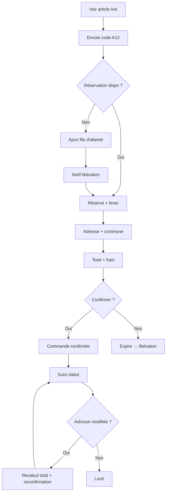
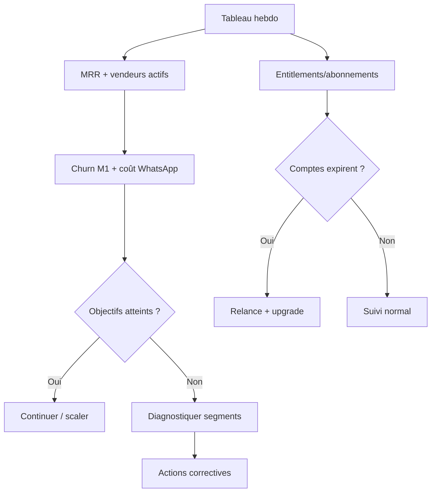

# UX Design Specification VenteFlash

**Author:** Fabrice
**Date:** 2026-01-23

---

<!-- UX design content will be appended sequentially through collaborative workflow steps -->

## Executive Summary

### Project Vision
VenteFlash doit offrir une expérience “ops” ultra légère pour vendre en social commerce : WhatsApp reste l’interface principale, et le dashboard sert à préparer (catalogue, livraison, templates) et piloter (statuts, validations, erreurs). Le différenciateur UX central est le mode live-first : réservation atomique, file d’attente, expiration, avec actions en 1–2 taps pour une vendeuse solo.

### Target Users
- **Vendeuse solo live (Aïcha)** : besoin d’un flux très rapide, sans assistante.
- **Boutique catalogue (Mariam)** : besoin de catalogue simple + suivi pro.
- **Manager multi-agents (Kader)** : besoin de supervision et de standardisation.
- **Client final** : besoin de clarté, confirmation et suivi.
- **Owner/Admin** : besoin de métriques business visibles.

### Key Design Challenges
- Maintenir un flux live ultra rapide (1–2 taps) sans écran complexe.
- Concevoir WhatsApp comme UI principale + dashboard comme console ops.
- Gérer les états critiques (réservé / expiré / confirmé) sans ambiguïté.
- Offrir un onboarding ultra court (WhatsApp + livraison + 1er item).

### Design Opportunities
- Duo “conversation design + console ops” très fluide.
- Vue “pipeline live” claire pour réduire disputes et no-show.
- Templates et statuts pensés comme raccourcis d’exécution.
- Design adapté mobile (vendeuse souvent sur téléphone).

## Core User Experience

### Defining Experience
La boucle centrale pour la vendeuse est la gestion des commandes et des statuts (“à confirmer → confirmé → préparation → livraison → livré”). L’action critique à rendre magique est la création rapide d’un item live (code + prix + description) et la confirmation d’une réservation en 1–2 taps, avec option “photo + code” pour attacher une preuve visuelle.

### Platform Strategy
- **Dashboard** : web app responsive (desktop + mobile), utilisé en mobilité par les vendeuses.
- **Client** : WhatsApp est l’interface principale.
- **Distribution** : mobile‑first pour les vendeuses solo, desktop pour boutiques/équipes.

### Effortless Interactions
Automatiser sans effort :
- attribution “premier arrivé”
- file d’attente + rang
- expiration T+X + libération + notification
- création commande + numéro
- collecte guidée adresse
- calcul frais livraison
- notifications de statut
- opt‑out “STOP”

Vendeur garde la main :
- validation/refus preuve paiement
- modification adresse/total + reconfirmation
- annulation/rupture
- gestion litiges (forcer attribution)
- handoff humain

Règle de friction : objectif ≤ 7 interactions client pour passer de “code” à “commande confirmée” (hors preuve paiement).

### Critical Success Moments
- **Moment “this is better”** : fin de live avec une liste propre “confirmé → à livrer” sans tri manuel ni disputes.
- **Moment make‑or‑break** : si réservation/expiration bugge ou latence en live → perte de confiance immédiate.
- **Second make‑or‑break** : flow client trop long → abandon.

### Experience Principles
- Live‑first = vitesse > complexité.
- WhatsApp comme UI principale, dashboard comme console.
- 1–2 taps pour toute action critique.
- Automatiser le répétitif, laisser l’humain gérer l’exception.
- Fallback permanent : réponses texte courtes (“1”, “2”, “CONFIRMER”) + capture client si la vendeuse ne peut pas envoyer la photo.

## Desired Emotional Response

### Primary Emotional Goals
- **Sérénité immédiate en live** : “je maîtrise, je ne me noie pas.”

### Emotional Journey Mapping
- **Découverte** : curiosité → “ça peut me sauver” → confiance (preuve sociale).
- **Pendant le live** : excitation → montée de charge → VenteFlash absorbe → calme + contrôle.
- **Après livraison** : satisfaction → fierté → routine + envie de scaler.

### Micro-Emotions
- Clarté
- Contrôle
- Confiance
- Vitesse
- Soulagement

### Design Implications
- **Sérénité** → interface ultra légère, feedback immédiat, statuts visibles.
- **Contrôle** → file d’attente claire, timestamps, historique.
- **Confiance** → confirmations explicites, preuves visuelles, stabilité live.
- **Soulagement** → automatisation des relances et de la collecte d’adresse.
- **Fierté** → commandes numérotées, suivi client “pro”.

### Emotional Design Principles
- Rendre visible la maîtrise (statuts, ordre d’arrivée).
- Réduire la charge mentale par l’automatisation.
- Toujours offrir un plan B (fallback texte, handoff).
- Rassurer en continu (notifications, confirmations).

## UX Pattern Analysis & Inspiration

### Inspiring Products Analysis
- **Login/Signup (login-signup.png)** : onboarding propre, split layout, bénéfice clair + confiance. À adapter en flow “activation rapide”.
- **Order Queue (order-queue.png)** : pipeline visuel + cartes + statuts, très clair pour gérer réservations et attentes.
- **Seller Live Dash (seller-live-dash.png)** : KPI + flux live + alertes + actions rapides, utile comme console ops minimaliste.

### Transferable UX Patterns
**Onboarding / Activation**
- Signup orienté activation : Nom boutique + téléphone WhatsApp (email optionnel).
- Étape immédiate : Connecter WhatsApp → Grille livraison → 1er item live.
- Preuve sociale locale : “Utilisé par X vendeuses à Abidjan” + 2–3 bénéfices.

**Navigation**
- Sidebar simple avec 4–6 entrées max (focus pipeline + clients + settings).
- Mode Live mis en évidence (badge “Live On”, statut bot visible).

**Interaction**
- Cartes avec actions critiques visibles (Confirmer, Libérer, Prolonger).
- Timers dominants (“Expire dans X:XX”).
- Toggle “Auto-notify waitlist” → paramètre Live “Auto passer au suivant”.
- Rail Waitlist collapsible en mobile.

**Visual**
- UI claire, cartes lisibles, CTA primaires visibles.
- Distinction visuelle forte “Réservé” vs “Confirmé”.
- Hiérarchie d’urgence : les expirations remontent en premier.

### Anti-Patterns to Avoid
- Dashboards surchargés avec trop de KPI secondaires.
- Onboarding long (type Notion) avant accès au live.
- Actions critiques cachées derrière menus profonds.
- Statuts ambiguës (Réservé vs Confirmé trop proches visuellement).

### Design Inspiration Strategy
**Adopt**
- Pipeline + cartes + timers (order-queue).
- Onboarding split-layout court (login-signup).

**Adapt**
- KPI du live dashboard : 2–3 max (Réservations, Expirent bientôt, Confirmées).
- Widgets indispensables : “Expiring soon” + “À valider paiement”.
- Badge BOT ACTIVE / LIVE ON visible et contrôlable.

**Avoid**
- Navigation lourde, analytics trop denses.
- Multi-étapes complexes pour confirmer une réservation.

## Design System Foundation

### 1.1 Design System Choice
**Choix :** Design system thémable (base Tailwind + composants shadcn/ui).

### Rationale for Selection
- **Vitesse de delivery** sans designer dédié, avec UI propre par défaut.
- **Cohérence** pour dashboard SaaS + workflow live.
- **Personnalisation progressive** (charte légère aujourd’hui, branding plus tard).
- **Compatibilité React/Next.js** et écosystème Tailwind.

### Implementation Approach
- Utiliser une base Tailwind + shadcn/ui comme fondation.
- Standardiser les patterns récurrents (cards, badges, tables, timers).
- Définir un set minimal de tokens (couleurs, typographie, espacements).
- Accessibilité “light” : contraste lisible, focus states, texte > 14px sur mobile.

### Customization Strategy
- Thème clair par défaut, adaptabilité mobile.
- Tokens pour statuts critiques (Réservé/Confirmé/Expiré).
- Styles “Live Mode” plus compacts (stress mode).

### Composants clés à standardiser
- Colonnes Kanban (Reserved/Confirmed/Shipping).
- Empty states (aucune réservation / aucun live).
- Toasts (confirmations rapides).
- Status chips (réservé/confirmé/expiré/paiement en attente).

## 2. Core User Experience

### 2.1 Defining Experience
“Le guichet automatique de ton live : tu annonces un code, VenteFlash réserve, trie et transforme les DM en commandes prêtes à livrer.”

### 2.2 User Mental Model
- Le live est un “marché WhatsApp” : le plus rapide gagne, mais c’est chaotique.
- Elle raisonne en “qui a dit je prends en premier ?” + “à qui je réponds maintenant ?”.
- Astuces actuelles : codes improvisés (A1/A2), captures d’écran, messages épinglés, notes, relances manuelles.

### 2.3 Success Criteria
- Chaque code devient une carte avec **1 gagnante + une file** visible.
- Timer “Expire dans X:XX” + statuts nets (Réservé → Confirmé).
- En live, l’UI priorise toujours ce qui expire bientôt (ordre par urgence).
- Fin de live : liste “Confirmé → à livrer” sans tri manuel.
- Délai de confirmation : 10 min par défaut (tunable 5–15).

### 2.4 Novel UX Patterns
- Pipeline/kanban établi pour l’exécution.
- Interaction signature “live allocation” (réservation atomique + queue + expiration).
- Twist VenteFlash : code‑first + anti‑litige (journal horodaté) + photo attachable.

### 2.5 Experience Mechanics
- **Init** : LIVE ON, durée de réservation, grille livraison.
- **Interaction** : création A12 (prix + description) + annonce “envoyez A12”.
- **Feedback** : réservation #1 + file #2/#3 + timer + notifications.
- **Completion** : réservation confirmée → commande créée + statut “à livrer”.
- **Fallback solo** : si la vendeuse ne peut pas ajouter de photo, flow “code seul” + capture client optionnelle.

## Visual Design Foundation

### Color System
**Direction :** Indigo énergie + cyan tech, avec accents “succès/urgence”.

**Palette (proposée)**
- Primary (Indigo): #4F46E5
- Primary Dark: #3730A3
- Cyan Accent: #06B6D4
- Success: #22C55E
- Warning: #F59E0B
- Error: #EF4444
- Neutral 900: #0F172A
- Neutral 700: #334155
- Neutral 200: #E2E8F0
- Neutral 50: #F8FAFC

**Sémantique**
- Réservé = Indigo
- Confirmé = Vert
- Expiré = Rouge
- Expire bientôt = Amber (< 2 min) + timer + placement en haut de liste
- File d’attente = Cyan
- Paiement en attente = Amber
- Paiement validé = Vert
- Paiement refusé = Rouge

### Typography System
- **Primary font:** Manrope
- **Tone:** moderne, clair, pro
- **Scale (exemple)**
  - H1 28–32 / 700
  - H2 20–24 / 600
  - H3 16–18 / 600
  - Body 14–16 / 400–500
- **Mobile min:** 14px

### Spacing & Layout Foundation
- **Base spacing:** 8px
- **Grid:** 12 colonnes desktop, 4 colonnes mobile
- **Densité:** équilibrée par défaut
- **Mode Live compact:** réduit paddings + hauteur des cartes

### Accessibility Considerations
- Contraste lisible (AA quand possible)
- Focus states visibles
- Cibles tactiles ≥ 44px
- Couleurs d’état toujours doublées par label/badge

## Design Direction Decision

### Design Directions Explored
- 6 variations basées sur le mix Live Pipeline + Proof (voir `/_bmad-output/planning-artifacts/ux-design-directions.html`).
- Variations de densité, colonne preuve, KPI live, mobile compact.

### Chosen Direction
**Direction 1 — Live Pipeline Focus**

### Design Rationale
- Pipeline clair pour le live, avec timers dominants et actions visibles.
- Priorité “expire bientôt” pour réduire la panique.
- Compatible mode compact mobile sans perdre la lisibilité.

### Implementation Approach
- Adopter la structure pipeline + cartes comme layout principal.
- Ajouter une colonne “Proof Lane” en variation secondaire (optionnelle) si volume paiement élevé.
- Conserver un mode compact pour live intense.

## User Journey Flows

### 1) Vendeuse Live — code → réservation → confirmation → livraison
**Objectif:** Transformer un code live en commande confirmée, avec preuve optionnelle.

---

### 2) Cliente — code → attente → notification → confirmation → suivi
**Objectif:** Réserver une pièce et suivre sa commande sans relance.

---

### 3) Owner/Admin — suivi business hebdo + décisions
**Objectif:** Vérifier valeur business + gérer abonnements.

### Journey Patterns
- Étapes courtes, feedback immédiat, statuts explicites.
- Timers + ordre d’urgence pour live.
- Confirmation explicite + relances minimales.

### Flow Optimization Principles
- ≤ 7 interactions client (hors preuve paiement).
- Actions critiques visibles sans scroll.
- Fallback texte en cas de boutons indisponibles.

## UX Consistency Patterns

### Button Hierarchy
- **Primary (Live)** : Confirmer (crée/lie une commande Confirmée).
- **Secondary** : Libérer (remet dispo / passe au suivant).
- **Tertiary** : Prolonger (+X min), Voir détails.
- **Garde-fou** : actions irréversibles (Confirmer/Vendu, Libérer) → snackbar Undo 5s si possible, sinon confirmation rapide.
- **Prolonger** : +X min configurable (ex 5), limite max 2 prolongations.

### Feedback Patterns
- **Urgence** : badge + timer sur la carte + tri en haut + banner discret “X réservations expirent bientôt”.
- **Erreur critique** : modal bloquant si état incohérent (ex: double attribution).
- **Erreur non critique** : toast + entrée dans file d’erreurs ops.

### Form Patterns
- **Validation** : inline + re-check au submit.
- **Messages** : courts (“Commune obligatoire”) + lien “détails” si nécessaire.

### Navigation Patterns
- **Desktop** : sidebar fixe.
- **Mobile** : bottom bar (3–4 onglets max) + actions live en haut.
- **Live mode** : écran dédié + toggle LIVE ON/OFF visible.

### Empty & Loading States
- Tonalité informative + action (“Aucun live en cours — Créer un item A12”).
- Visuels simples : texte + icône (pas d’illustrations lourdes au MVP).

### Search & Filters
- **Live board** : statut (Disponible/Réservé/Vendu), Expire bientôt, Avec file, option “Avec photo”.
- **Commandes** : statut, paiement en attente, date (aujourd’hui).

### Status Language & Naming
- **Confirmer = Confirmé** (commande).
- **Vendu = état item live**.
- **Item live** : Disponible → Réservé → Vendu (Expiré = événement/historique).
- **Commande** : Nouveau/À confirmer → Confirmé → Préparation → En livraison → Livré/Annulé.
- **Paiement** : Non payé → En attente → Validé/Refusé.

### Mobile Interaction Patterns
- **Swipe actions** : limitées (gauche = Libérer, droite = Confirmer) + confirmation rapide.
- **Bottom sheet** : actions rapides + détails (éviter modales lourdes).
- **Mode Live compact** : toggle visible (paddings réduits).

## Responsive Design & Accessibility

### Responsive Strategy
**Desktop**
- Pipeline commandes ou Live Board en vue principale.
- Panneau latéral contextuel (détails + actions).
- KPIs légers en header (2–3 max).

**Mobile**
- Priorité : timers + état + actions (cartes live compactes).
- Focus unique : liste → bottom sheet pour détails/actions.
- Quick actions visibles (LIVE ON/OFF, Create code).

**Tablet**
- Proche desktop (2 colonnes) si possible.
- Fallback mobile (1 colonne + bottom sheet) sinon.

### Breakpoint Strategy
- Breakpoints Tailwind : `sm 640 / md 768 / lg 1024 / xl 1280`.
- Support minimal 320px.

### Accessibility Strategy
- **Target** : AA quand possible, minimum A garanti.
- Contraste AA pour statuts live + timers.
- Focus visible sur toutes actions clavier.
- Couleur jamais seule (labels + icônes).
- Min 14px mobile + line-height confortable.

### Testing Strategy
- Android low‑end (Chrome) priorité #1.
- iPhone récent (Safari).
- Desktop 1366×768 + 1920×1080.
- Browsers : Chrome, Safari, Edge (Firefox smoke).

### Implementation Guidelines
- Mobile‑first.
- Cibles tactiles ≥ 44px confirmées.
- Bottom sheets préférés aux modales sur mobile.

## Component Strategy

### Design System Components
**shadcn/ui (base)**
- Buttons, inputs, selects, tabs, cards, badges, toasts
- Tables, dropdowns, dialogs, tooltips
- Tabs + filters + pagination
- Empty states de base

### Custom Components

#### Live Item Card
**Purpose:** gérer un item live en 1–2 taps
**Content:** code, prix, description, photo, statut, timer
**Actions:** Confirmer, Libérer, Prolonger
**States:** disponible, réservé, expire bientôt, expiré, vendu
**Variants:** mode compact live
**Accessibility:** focus actions, labels statut
**Rule:** “Confirmer” = passe l’item en Vendu + crée/lie une commande Confirmée (si pas déjà fait).

#### Reservation Timer Chip
**Purpose:** rendre l’urgence visible
**Content:** “Expire dans 02:34”
**States:** normal, expire bientôt (<2 min), expiré
**Variants:** inline / badge

#### Waitlist Queue Rail
**Purpose:** gérer rangs #1/#2/#3
**Content:** rang, client, auto-pass, actions
**Actions:** notifier, retirer, bump, passer au suivant (force release + notif #1)
**States:** actif, auto-pass ON/OFF
**Variants:** collapsible mobile

#### Live Board
**Purpose:** vue live centrée sur l’urgence
**Content:** tri par expiration, filtres dispo/réservé/vendu
**Actions:** quick filters, bulk release

#### Proof Validation Panel
**Purpose:** valider preuves paiement
**Content:** preuve, montant attendu, note
**Actions:** Valider/Refuser
**States:** non payé, en attente, validé, refusé, partiel
**Extras:** preview/zoom preuve, champ “montant reçu” (optionnel), raison de refus (liste courte)

#### WhatsApp Connection & Live Status Banner
**Purpose:** statut bot + live
**Content:** connecté/déconnecté, LIVE ON/OFF, alertes
**States:** Connecté, Déconnecté, Dégradé (taux d’échec élevé), Templates requis
**Actions:** toggle, reconnect

#### Quick Actions Bar
**Purpose:** actions rapides
**Content:** Create code, LIVE ON/OFF, Export, Messages
**States:** actif/inactif

### Component Implementation Strategy
- Construire tous les custom components sur tokens (couleurs statuts, timers).
- Réutiliser cards/badges shadcn comme base.
- Prioriser l’accessibilité (focus states + labels).
- Garder versions compactes pour mode live.

### Implementation Roadmap
**Phase 1 (MVP Core)**
1) Live Item Card + Timer Chip
2) Waitlist Queue Rail
3) Proof Validation Panel
4) Live Board (version simple, tri par urgence)

**Phase 2**
- WhatsApp Status Banner
- Quick Actions Bar

**Phase 3**
- Variants avancées + kanban complet
- Analytics widgets
